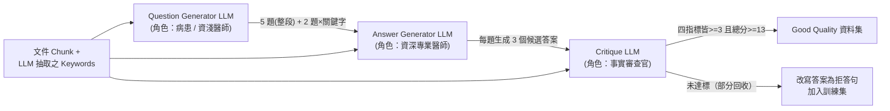

# LLM 合成問答與 Critique 過濾管線

> **一句話直覺**：在缺乏人工標註的封閉領域，把一組通用開源 LLM 拆成「**提問者 → 作答者 → 嚴格審查官**」三條流水線，從原始文件段落自動量產並過濾出高品質微調資料集。

---

## 1. 核心設計與分工架構
相較於 Self-Instruct 或 Evol-Instruct 靠模型自身記憶發散造題，封閉領域文件合成管線必須**嚴格錨定（Grounded）在切分好的文件 Chunk 上**。在 [Wu (2024)](../papers/2024-wu-llm-finetune-dataset-from-unstructured-data.md) 中，這套流水線拆為三個可獨立替換模型的模組：

---

## 2. 關鍵工程技巧（Chunking / Generation / Critique Prompt）

### 2.1 針對繁中文件的 Chunking 與關鍵字雙軌產題
- **標點斷點優先於硬切與重疊**：[Wu (2024)](../papers/2024-wu-llm-finetune-dataset-from-unstructured-data.md) 使用 Recursive Text Splitter 並加入全形標點（`，`、`、`、`．`、`。`、`\u200B`），實驗發現 `chunk=512, overlap=0` 在 Top-1 檢索命中率明顯優於 `overlap=100`。
- **關鍵字定向產題（破除段落視角單一化）**：若只讓 LLM 讀整段 chunk 提問，問題往往只重複段落大標題。先用 LLM 抽出 chunk 關鍵字（如特定基因名稱 `POU3F4(DFNX2)`），再強制針對每個關鍵字額外生成 2 題，可大幅提升問題覆蓋面與多樣性。

### 2.2 角色扮演（Role-Playing）Prompt
- **Question Generator**：設定為「前來問診的病患」或「想學習知識的資淺醫師」，引導模型用貼近真實使用者的口吻提問，而非死板的閱讀測驗題。
- **Answer Generator**：設定為「資深專科醫師」，限制僅依據給定 chunk 作答並輸出多組候選答案（3 個），提高後續篩出高品質回覆的機率。

### 2.3 多維度 Critique LLM（LLM-as-a-Judge）與格式控制
使用 4 個獨立 Prompt 對資料品質打 1–5 分並要求輸出理由（Chain-of-Thought 風格，強迫格式以 `評分:` 與 `評估:` 開頭，解析失敗則自動重試）：

| 指標 | 審查目標 | 門檻設定 | 工程設計注意點 |
| :--- | :--- | :---: | :--- |
| **Groundedness** | 是否能依據內文毫不含糊回答 | ≥ 3 / 5 | ⚠️ [Wu (2024)](../papers/2024-wu-llm-finetune-dataset-from-unstructured-data.md) 附錄 Prompt 僅輸入 `Q + Context` 未輸入 `Answer`；**實際部署建議改為同時輸入 `Q + A + Context` 以確實擋下幻覺答案**。 |
| **Relevance** | 是否符合目標使用者（病患）真實提問情境 | ≥ 3 / 5 | 過濾過於冷僻、只有讀過原文才會問的假問題。 |
| **Standalone** | 問題是否可獨立理解 | ≥ 3 / 5 | 明確在 Prompt 規定出現「在內文中」「在檔案中」一律給 1 分（極實用的規則）。 |
| **Similarity** | 問題與答案是否句型過度雷同 | ≥ 3 / 5 | 防止模型用「複述題目」混充答案。 |
| **總分門檻** | 四項加總 | **≥ 13 / 20** | 同時卡單項底線與總分，避免單一高分掩蓋嚴重缺陷。 |

### 2.4 異質模型分工（Heterogeneous Model Pairing）
[Wu (2024)](../papers/2024-wu-llm-finetune-dataset-from-unstructured-data.md) 的實務發現極具參考價值：**不必用同一個模型包辦生成與審查**。
- 不同模型的審查嚴格度差異極大：同樣的 Critique Prompt，**Breeze-7B 的通過率僅 35.7%–37.3%**，而 **TAIDE-8B 卻放行高達 79.9%–88.5%**。
- 搭配「語料豐富的模型當 Generator（TAIDE）＋ 審查嚴格的模型當 Critique（Breeze）」，能產出比單一模型自產自審更高品質的微調資料集。

### 2.5 低品質資料轉「拒答樣本」的雙面刃
把未通過審查的問題保留下來、將答案統一改成「非常不好意思，目前沒辦法回答您的問題」是一種零額外成本構造負樣本的巧思；但需注意**負樣本比例過高會導致模型在正例上過度拒答**（[Wu (2024)](../papers/2024-wu-llm-finetune-dataset-from-unstructured-data.md) Table 4.7 vs. 4.8 顯示，在全正例測試集上移除該批樣本可讓 F1 由 `0.4184` 升至 `0.5556`）。

---

## 3. 優缺點與適用場景
- **優點**：成本與時間遠低於人工標註（從數週／數月壓縮至數小時至數天）；高度模組化，隨時可替換更新更強的開源 LLM。
- **缺點**：品質天花板受制於 Generator 與 Critique 模型本身能力及 Prompt 穩定度；若 Critique Prompt 漏審答案忠實度，幻覺會直接污染微調資料集。

---

## 4. 引用與實踐此概念的論文
- [Wu (2024) 基於 LLM 自非結構化文件建立微調資料集](../papers/2024-wu-llm-finetune-dataset-from-unstructured-data.md) — 完整實作 11 題/chunk 生成、3 候選答案、四指標 Critique Prompt（≥3 且總分 ≥13）及 Breeze/TAIDE 異質組合實驗。

## 相關頁面
- 下游微調範式：[RAFT（Retrieval Augmented Fine-Tuning）](./raft.md)
- 延伸跨論文機制：[異質多模型協作與互補效應](./heterogeneous-multi-llm-collaboration.md)
- 主題綜述：[封閉領域知識導入 LLM 路線總覽](../topics/domain-specific-llm-adaptation.md)
- 相關簡報：[LLM 合成問答與 Critique 過濾管線（HTML 投影片）](../../slides/2026-11-23-llm-synthetic-qa-critique-pipeline.html)
