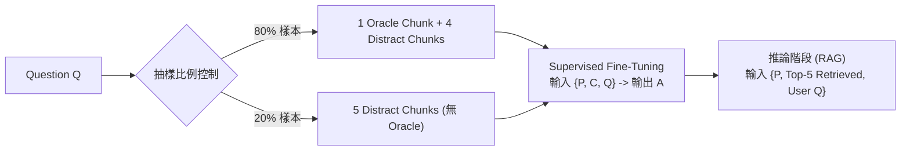

# RAFT（Retrieval Augmented Fine-Tuning）

> **一句話直覺**：讓 LLM 在微調階段就練習「**開書考（Open-Book Exam）**」——不是死背整本教科書（純微調），也不是考前沒讀過書只靠現場翻書（純 RAG），而是考前先帶著書、混著幾頁無關的干擾頁反覆練習找重點作答。

---

## 1. 核心問題與直覺定義
傳統把領域知識導入 LLM 的兩種主流做法各有盲點：
- **純 RAG（Retrieval-Augmented Generation）**：推論時才把檢索到的段落塞進 Prompt，但模型未必熟悉該領域術語，也容易被檢索出來的干擾段落（Distractor Documents）誤導，尤其在 7B–8B 級距的小模型上更明顯。
- **純 Fine-tuning（如 SFT 或 TAPT）**：強迫模型把所有事實壓進權重參數中，但資料量少時很難完整記住細節，推論時也沒學會如何利用外部檢索段落。

**RAFT**（最早由 Zhang et al., 2024 提出）結合兩者：在訓練資料中直接模擬 RAG 推論環境，讓模型同時學習**領域知識**與**從含雜訊的檢索結果中擷取正確證據（或忽略干擾）**的能力。

---

## 2. 技術表述與資料建構規則

每筆 RAFT 訓練樣本的形式為 `{P, C, Q, A}`：
- **`P`（Prompt）**：系統角色與作答規則（訓練期與推論期必須保持一致）。
- **`C`（Context Chunks）**：一組共 $k$ 段候選文件，由「正確證據段落（Oracle / Generation Chunk $d^*$）」與「隨機干擾段落（Distractor Chunks $d_i$）」混合構成。
- **`Q`（Question）**：針對領域文件生成的問題。
- **`A`（Answer）**：對應的正確回答。

### 關鍵比例設計（$P\%$ 含正解 vs. $(1-P)\%$ 純干擾）
依 Zhang et al. (2024) 與 [Wu (2024)](../papers/2024-wu-llm-finetune-dataset-from-unstructured-data.md) 的實作設定（取 $P = 80\%$、總段落數 $k = 5$）：
- **80% 訓練樣本**：`C = {1 個正確 generation chunk + 4 個隨機 distract chunks}` → 訓練模型在雜訊中精準定位正解段落、忽略干擾。
- **20% 訓練樣本**：`C = {5 個 distract chunks（不含正解）}` → 訓練模型在 Retriever 失手漏檢時，仍能仰賴微調記住的領域知識作答（或依 Prompt 規範妥善處理）。

---

## 3. 工程實作注意事項
1. **訓練與推論的 Prompt 一致性**：[Wu (2024)](../papers/2024-wu-llm-finetune-dataset-from-unstructured-data.md) 特別強調訓練與推論使用完全相同的 System Prompt 與段落數（`top-k = 5`），並設定 `max_seq_length = 1600` 確保 5 段 `chunk_size = 512` 的文字不會被截斷（實務上中文 token 與字元比例需實測確認是否超長）。
2. **干擾段落的挑選策略**：基礎版直接從向量庫隨機抽樣 distract chunks；進階做法可抽「語意相近但非正解」的 Hard Negatives，讓模型更具抗干擾能力。
3. **與拒答機制的衝突平衡**：若在 20% 無正解樣本要求模型硬靠記憶答對，同時又在另批低品質問題訓練模型「沒找到就拒答」，兩者訊號可能互相拉扯，實作上必須明確界定何時憑記憶答、何時拒答。

---

## 4. 優缺點與適用場景
- **優點**：
  - 在小參數開源模型（如 Breeze-7B、TAIDE-8B、Llama-2）上效果極顯著：[Wu (2024)](../papers/2024-wu-llm-finetune-dataset-from-unstructured-data.md) Table 4.9 顯示 Breeze-7B 單用 Fine-tune（F1 `0.3608`）或單用 RAG（F1 `0.3471`）幾乎無感，改用 RAFT（Fine-tune + RAG）後 F1 躍升至 `0.5556`。
  - 搭配 QLoRA（如 `r = 64`）即可在有限 GPU 記憶體下完成訓練。
- **缺點**：
  - 高度依賴高品質的 `(Chunk, Q, A)` 訓練集，需搭配 [LLM 合成問答與 Critique 過濾管線](./llm-synthetic-qa-critique-pipeline.md) 或人工標註。
  - 若底層知識頻繁變動，微調後的模型雖然能靠 RAG 更新事實，但過時記憶仍可能造成干擾。

---

## 5. 引用與實踐此概念的論文
- [Wu (2024) 基於 LLM 自非結構化文件建立微調資料集](../papers/2024-wu-llm-finetune-dataset-from-unstructured-data.md) — 將 RAFT（80%/20% 比例、top-5 chunks、QLoRA rank=64）套用於台大醫院繁中耳科文件、PubMedQA 與 PrivacyQA，驗證 Fine-tune + RAG 的顯著綜效。

## 相關頁面
- 主題綜述：[封閉領域知識導入 LLM 路線總覽](../topics/domain-specific-llm-adaptation.md)
- 上游資料管線：[LLM 合成問答與 Critique 過濾管線](./llm-synthetic-qa-critique-pipeline.md)
