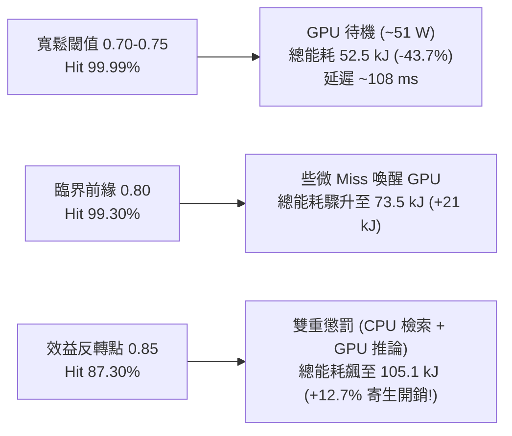

# 語意快取與效益反轉點（Benefit Inversion Point）

> **一句話直覺**：語意快取把重複語意問句從「吃電怪獸 GPU」卸載給「省電的 CPU＋向量庫」；但**相似度閾值調太嚴時，每次沒命中都得先付 CPU 檢索費、再付全額 GPU 推論費（雙重懲罰）**，總耗電量反而不降反升！

---

## 1. 運作機制（以 GPTCache 為代表）
傳統 Key-Value 快取只認完全相同的字串（Exact Match），無法處理自然語言改寫（如 `"How far is LA from NYC?"` vs `"What is the distance between New York and Los Angeles?"`）。語意快取改走向量空間：
1. **Embedding**：將使用者提問轉成向量；
2. **Vector Search**：在向量庫（如 `pgvector`）搜尋 Top-k 最相近的歷史提問；
3. **閾值判定（`similarity_threshold`）**：
   - **Cache Hit（$\ge \tau$）**：直接從 Scalar DB（如 PostgreSQL）回傳歷史答案，完全跳過 GPU LLM 推論；
   - **Cache Miss（$< \tau$）**：將提問轉送後端 LLM（如 Ollama Mistral-7B）生成答案，再寫回向量庫與答案庫。

---

## 2. 效益反轉點與雙重懲罰（[Chen, 2025](../papers/2025-chen-semantic-caching-energy-tradeoff.md) 核心發現）

- **非線性敏感度**：在 NVIDIA T4 + 4-bit Mistral-7B 環境下，命中率從 `99.99%` 微跌 `0.69%` 到 `99.30%`，總能耗立刻跳升逾 `21,000 J`。
- **寄生負債（Parasitic Overhead）**：當閾值 ≥ `0.85` 時，即便命中率仍高達 `87.30%`，系統總平均功率（`175.22 W`）已超過無快取基準（`155.88 W`），證明「盲目預設裝快取」可能適得其反。

---

## 3. 工程調校與避坑要點
1. **閾值必須視為生產環境監控指標**：不能沿用預設值不動，須搭配即時 Hit Rate 與功耗觀測動態校準。
2. **補齊「正確率（False Positive）」維度**：寬鬆閾值雖極度省電，但容易誤配不相關答案；若流量含大量非重複新問句，反轉點會更早發生（詳見 [QQP 壓測基準盲區](../benchmarks/qqp-semantic-cache.md)）。
3. **進階演進方向**：結合語意聚類淘汰（SCALM）、使用者上下文雜湊鍵（Context Hashkey）、以及與即時電網碳強度連動的 Carbon-Aware K8s Operator 動態調閾。

---

## 4. 引用與實踐此概念的論文
- [陳冠錞 (2025) LLM 推論中語意快取的能耗與效能權衡](../papers/2025-chen-semantic-caching-energy-tradeoff.md) — 首次在 GKE（Kepler + DCGM）量化語意快取之總焦耳能耗曲線與 `0.85` 效益反轉點。

## 相關頁面
- 主題綜述：[LLM 推論效率、量化部署與綠能權衡](../topics/llm-inference-efficiency-and-deployment.md)
- 壓測基準：[QQP 語意快取壓測基準](../benchmarks/qqp-semantic-cache.md)
