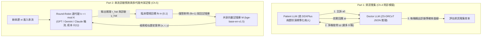

# 大型語言模型進行醫療診斷推理（Wu, C.-K., 2024）

> **一句話總結（TL;DR）**：針對臨床問診（History Taking）的「資訊蒐集」與「診斷預測」兩大能力，提出**免微調（Pure In-Context）三部曲**：① 仿標準化病人的 **LLM 角色扮演評估框架**；② 將醫師臨床思維編入 JSON 模板的 **`ZS-DRCoT`**；③ 讓多款異質 LLM 輪詢作答且共享正確推理經驗的 **Round-Robin Multi-Agent Memory**，在 DDXPlus 上將診斷準確率由 `52.85%` 推升至 `90.48%` 且維持 $O(1)$ 推論成本。

---

## 1. 研究動機與問題定義
- **臨床價值**：文獻指出僅靠問診（History Taking）就能在約 75% 的門診案例中提供足夠診斷資訊，大幅減少不必要檢驗成本。
- **傳統自動問診（RL / 微調 Transformer）的三大限制**：
  1. 需昂貴的醫療對話標註資料訓練；
  2. 動作空間固定（限縮於預定義症狀清單，無法自由自然語言發問）；
  3. 採用「查表式病人模擬器」，偏離真實臨床自然語言互動。
- **核心問題**：不進行任何模型權重微調，能否直接激發通用 LLM 潛在的醫療診斷推理能力，並讓模型在臨床串流環境中隨看診經驗**持續自我進步**？

---

## 2. 前置知識（Prerequisites）
- [醫師診斷思維鏈與多代理共享記憶](../concepts/diagnostic-reasoning-cot-and-shared-memory.md) — `DR-CoT` / `ZS-DRCoT` JSON 結構與 Round-Robin 串流記憶演算法細節。
- [異質多模型協作與互補效應](../concepts/heterogeneous-multi-llm-collaboration.md) — 本篇與 [吳葦誠 (2024)](./2024-wu-llm-finetune-dataset-from-unstructured-data.md) 兩篇獨立印證異質 LLM 互補之跨論文脈絡。
- [封閉領域知識導入 LLM 路線總覽](../topics/domain-specific-llm-adaptation.md) — 比較「免微調推理＋共享記憶」與「合成資料＋RAFT 微調」兩大醫療 LLM 路線。

---

## 3. 核心方法與工程實作細節



### 3.1 LLM 角色扮演評估框架（Ch.4）
- 借鏡醫學教育「標準化病人（Standardized Patients）」：
  - **Doctor LLM** $f(\cdot|\theta)$：依對話歷史 $H = [(a_0), (q_1, a_1), \dots, (q_\ell, a_\ell)]$ 產生提問 $q_i$（上限 $\ell = 8$ 輪）。
  - **Patient LLM** $g(\cdot|\theta)$：持有完整病歷 $P$，嚴格忠實依 $P$ 回覆自然語言 $a_i$。
  - **評估指標**：每隔數輪以相同診斷模板評估 $\hat{y}_\ell = f(p_{\text{make}}(D, H)|\theta)$ 的診斷準確率曲線（蒐集品質越高，準確率爬升越快）。

### 3.2 Few-Shot DR-CoT → Zero-Shot JSON `ZS-DRCoT`
- **Few-Shot DR-CoT**：在 $k=2$ 個問診範例中插入三步中間推理 $r_i$（陽性臨床表現、陰性臨床表現、鑑別診斷），但撰寫完整多輪醫療範例成本極高且推論 token 昂貴。
- **Zero-Shot `ZS-DRCoT`**（工程落地亮點）：完全不給範例，直接在 Prompt 強制要求每輪輸出結構化 JSON：
  ```json
  {
    "positive_clinical_findings": [],
    "negative_clinical_findings": [],
    "ranked_differential_diagnosis": [],
    "question_to_ask": ""
  }
  ```

### 3.3 串流共享記憶機制（Single-Agent & Multi-Agent Memory，Ch.5）
- **Single-Agent Memory ($K=1$)**：以 Key-Value 向量庫（`BAAI/bge-base-en-v1.5` 編碼病歷 $x_t$）檢索過往相似病例當動態 Few-shot；**只在預測正確（$fb_t = 1$）時才存入 $(x_t, \hat{r}_t, \hat{y}_t)$**，防止錯誤範例污染記憶庫。
- **Round-Robin Multi-Agent Memory ($K=3$)**：傳統多代理辯論／共識推論成本為 $O(K)$；本篇改採**輪詢排程（$k = t \bmod K$）**搭配**共享單一記憶庫 $\mathcal{M}$**，將推論成本壓回 **$O(1)$**，同時讓 GPT-3.5、Gemini-1.0、Claude-3-Haiku 彼此吸收對方的拿手病例推理！

---

## 4. 實驗設定與關鍵發現（[DDXPlus 基準頁](../benchmarks/ddxplus.md)）

### 4.1 問診資訊蒐集實驗（Ch.4，最多 8 輪，49 種診斷）
- **Few-Shot DR-CoT（`text-davinci-003`，$k=2$）**：
  - 同領域（ID，咳嗽主訴）：第 8 輪準確率由 Baseline `18.0%` 升至 **`33.5%`（+15.5%）**，各輪領先 `+15.5%`～`+21.5%`。
  - 跨主訴泛化（Out-of-Domain）：OD1 呼吸困難 `8% → 26%`（`+18.0%`）；OD2 鼻塞 `12% → 26%`（`+14.0%`）。
- **Zero-Shot `ZS-DRCoT` 跨 5 大 LLM 家族（Table 4.1，49 種診斷）**：
  | 模型 | Zero-Shot Baseline | **ZS-DRCoT** | 絕對提升 |
  | :--- | :---: | :---: | :---: |
  | `gpt-3.5-turbo-0125` | 17.63% | **24.75%** | +7.12% |
  | `gemini-1.0-pro-001` | 22.38% | **28.25%** | +5.87% |
  | `claude-3-haiku-20240307` | 18.13% | **25.63%** | +7.50% |
  | `mixtral-8x22b` | 21.13% | **25.63%** | +4.50% |
  | `llama-3-70b` | 18.88% | **21.25%** | +2.37% |
  | **5 模型平均** | **19.63%** | **25.10%** | **+5.48%（相對 +28.39%）** |
- **推理步驟消融（Table 4.3，3 模型平均）**：移除 `positive_clinical_findings` 暴跌 **`-7.67%`**（最關鍵）＞ 移除 `differential_diagnosis` 降 **`-4.67%`** ＞ 移除 `negative_clinical_findings` 降 `-2.00%`（但 GPT 移除陰性表現反而 `+2.50%`）。
- **診斷類別擴展性（Table 4.4）**：在 5 / 10 / 20 / 49 種診斷下，`ZS-DRCoT` 皆穩定領先，且類別越多、相對增益越大（GPT 在 49 類相對提升逾 +40%）。

### 4.2 診斷預測與串流共享記憶實驗（Ch.5，給定完整病歷，Table 5.1 & 5.2）
| 設定與方法 | GPT-3.5 | Gemini-1.0 | Claude-3-Haiku | 平均準確率 |
| :--- | :---: | :---: | :---: | :---: |
| Non-streaming Baseline | 47.56% | 50.57% | 60.43% | 52.85% |
| Non-streaming `ZS-DRCoT` | 53.18% | 59.30% | 62.13% | 58.20% |
| Streaming Baseline + Single-Agent Memory | 66.16% | 69.50% | 76.02% | 70.56% |
| Streaming Baseline + Multi-Agent Memory | — | — | — | 83.50% |
| Streaming `ZS-DRCoT` + Single-Agent Memory | 73.19% | 82.65% | 84.98% | 80.27% |
| **Streaming `ZS-DRCoT` + Multi-Agent Memory** | — | — | — | **90.48%** |

- **為何共享記憶有效（Fig. 5.3 混淆矩陣證據）**：三模型專長高度互補——GPT 擅長急性／過敏性鼻竇炎但常誤判慢性鼻竇炎與 URTI；Gemini 擅長 URTI；Claude 擅長慢性鼻竇炎。共享正確推理讓單一系統同時繼承三家強項。
- **反事實消融（Table 5.2，Algorithm 2）**：只用單代理寫記憶但多代理輪詢推論（Baseline + MAM ablation）可將 Gemini 推升至 `72.05%`、Claude 至 `81.52%`，而完整多代理記憶與推論更達 `83.50%`，證明「多代理記憶寫入」與「多代理推論」兩者皆有獨立貢獻。

---

## 5. 限制、批判與與既有知識的關係

### 作者自述限制（Ch.6）
- **缺乏自主停止準則（Stopping Criterion）**：問診固定跑滿 8 輪，模型尚無法判斷「何時資訊已足夠停止發問」。
- **提問策略未串流演進**：記憶機制僅應用於第 5 章診斷預測，尚未讓「怎麼問好問題」隨互動回饋持續優化。
- **記憶庫擴展與維護**：隨著看診量增加，記憶庫容量、檢索雜訊與過時病例治理待解。

### 批判性閱讀觀察
> [!WARNING]
> **1. 高複雜主訴下的負遷移（Table 4.2）**：當病患主訴為 **Shortness of breath（呼吸困難）** 時，`ZS-DRCoT` 在 5 模型平均反而比標準 Zero-shot **倒退 `-2.20%`**（Llama3 大降 `-10.50%`、GPT 降 `-5.00%`、Claude 降 `-2.00%`），顯示固定 JSON 推理模板並非對所有高歧義臨床主訴皆有利。

> [!WARNING]
> **2. 串流即時回饋假設與資料集真實性**：Ch.5 假設每次看診結束都能立刻拿到黃金標籤 $fb_t \in \{0, 1\}$ 決定是否寫入記憶庫，但真實臨床常需檢驗數日才確診；且 DDXPlus 為規則合成資料集（僅 49 種封閉診斷），真實電子病歷的噪聲與長尾疾病挑戰更高。

- **與 [吳葦誠 (2024)](./2024-wu-llm-finetune-dataset-from-unstructured-data.md) 的鮮明對比**：兩篇皆為台大資工 2024 醫療 LLM 碩論，前者靠「合成資料＋QLoRA/RAFT 改權重」把未公開耳科知識灌進 7B 小模型；本篇則在「模型已具基礎醫學知識（USMLE 程度）」前提下，完全不改權重，單靠「結構化 JSON CoT＋串流外掛記憶」就將準確率推到 `90.48%`。兩者亦共同證明了**異質模型互補**的強大紅利。

---

## 6. 讀書會討論題（Discussion Questions）
1. **記憶庫 vs. 微調**：如果把吳承光這套「只存答對案例的共享記憶庫」套用到吳葦誠的封閉耳科問答系統，會不會比重新做 QLoRA 微調更容易維護？兩者何時該選哪一個？
2. **為何「呼吸困難」用 `ZS-DRCoT` 反而變差？** 強制先列鑑別診斷會不會讓模型過早鎖定錯誤假設（錨定效應），反而問偏問題？
3. **無即時標準答案時怎麼更新記憶庫？** 若真實門診無法即時給 `fb_t = 1`，能否結合 [Critique LLM](../concepts/llm-synthetic-qa-critique-pipeline.md) 或醫師事後抽檢來替代？

---

## 相關頁面
- 主題綜述：[封閉領域知識導入 LLM 路線總覽](../topics/domain-specific-llm-adaptation.md)
- 核心概念：[醫師診斷思維鏈與多代理共享記憶](../concepts/diagnostic-reasoning-cot-and-shared-memory.md)、[異質多模型協作與互補效應](../concepts/heterogeneous-multi-llm-collaboration.md)
- 公開基準：[DDXPlus](../benchmarks/ddxplus.md)
- 跨論文對照：[吳葦誠 (2024) 基於 LLM 自非結構化文件建立微調資料集](./2024-wu-llm-finetune-dataset-from-unstructured-data.md)
