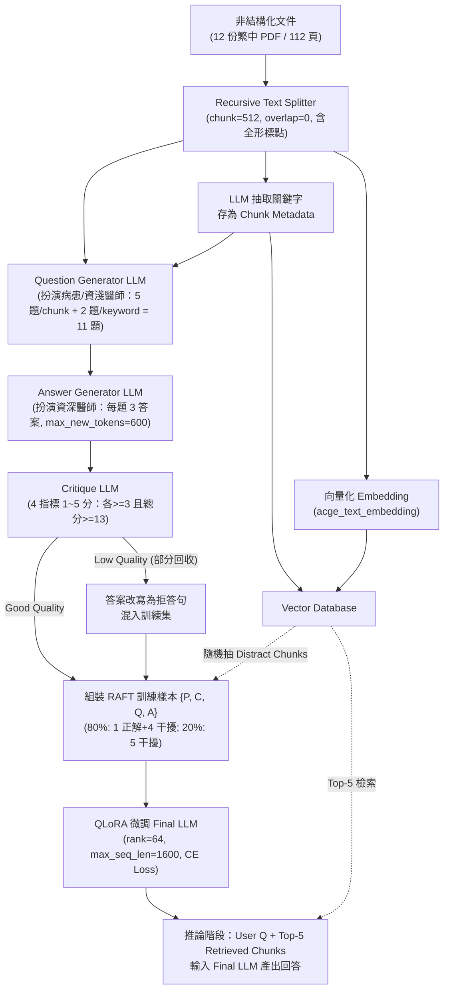

# 基於大型語言模型自非結構化文件建立微調資料集（Wu, 2024）

> **一句話總結（TL;DR）**：針對 LLM 預訓練未涵蓋的繁體中文封閉領域文件（台大醫院耳科遺傳性聽損 12 份 PDF），提出一套免人工標註、模組化的「**Chunking＋關鍵字抽取 → 多角色 Generator/Critique 合成與過濾 → RAFT 風格 QLoRA 微調 ＋ RAG 推論**」工程管線，證明單用 RAG 或單用微調改善有限，唯有兩者結合才大幅提升專業問答表現。

---

## 1. 研究動機與問題定義
- **封閉領域知識缺口與幻覺**：特定專業領域（例如台大醫院未公開的繁體中文兒童遺傳性聽力損失文獻）不在開源 LLM 的預訓練語料中，直接提問容易自信地產生幻覺（Hallucination）。
- **人工標註與既有合成法的痛點**：
  - 傳統專家標註微調資料集耗時數週至數月。
  - Self-Instruct、Evol-Instruct、GLAN 等方法仰賴 LLM 既有預訓練知識或專家種子範例，無法憑空生成封閉領域的正確知識。
  - Bonito（Conditional Task Generation）仍需額外訓練專屬的資料生成模型。
- **核心假設（Key Insight）**：不需要訓練特製生成器，只要用現成具備對話與 In-Context Learning 能力的開源 LLM 進行**角色扮演生成**與**多維度審查過濾**，再把資料包裝成 [RAFT](../concepts/raft.md)「開書考」格式進行微調，就能在數小時至數天內將任意非結構化文件轉化為專業問答系統。

---

## 2. 前置知識（Prerequisites）
閱讀本篇前建議先理解：
- [RAFT（Retrieval Augmented Fine-Tuning）](../concepts/raft.md) — 本篇訓練樣本建構（80% 含正解＋干擾段落、20% 純干擾段落）與開書考推論的核心範式。
- [LLM 合成問答與 Critique 過濾管線](../concepts/llm-synthetic-qa-critique-pipeline.md) — 角色扮演產題／產答、四維度 LLM-as-a-Judge 評分與低品質樣本轉拒答的設計原理。
- [封閉領域知識導入 LLM 路線總覽](../topics/domain-specific-llm-adaptation.md) — 理解本篇與 TAPT（Continuous Pre-training）、純 RAG、純 Instruction Tuning、Bonito 的定位差異。

---

## 3. 核心方法與工程實作細節

### 3.1 資料前處理與中英文 Chunking 工程細節
1. **斷點策略（Recursive Text Splitter）**：不以固定字元硬切，而是依序尋找最接近的語意斷點，特別針對繁中／日文加入全形標點（Table 4.2）：
   - 換行 `\n` (`\u000a`)、雙換行 `\n\n`、空白 `" "` (`\u0020`)、半形句點 `.` (`\u002e`)、半形逗號 `,` (`\u002c`)
   - 零寬空白 `\u200B`、全形逗號 `，` (`\uff0c`)、頓號 `、` (`\u3001`)、全形句點 `．` (`\uff0e`)、中文句號 `。` (`\u3002`)
2. **Chunk Size 與 Overlap 實測（Table 4.4）**：
   - 使用 INTSIG `aspire/acge_text_embedding`（基於 Matryoshka Representation Learning）建庫，並測試「用生成出的問題反查原始 chunk」的命中率：
     | 設定 `(chunk_size, overlap)` | 切出 Chunk 總數 | Breeze 提問 Top-1 | TAIDE 提問 Top-1 | Top-5 命中率 |
     | :--- | :---: | :---: | :---: | :---: |
     | `(256, 0)` | 458 | 0.6289 | 0.5942 | 1.000 |
     | `(256, 100)` | 688 | 0.5174 | 0.5032 *(原文筆誤 5032)* | 1.000 |
     | **`(512, 0)`** | **243** | **0.6748** | **0.6482** | **1.000** |
     | `(512, 100)` | 265 | 0.5720 | 0.5714 | 1.000 |
   - **工程洞見**：在所有模型與長度下，**`overlap = 0` 全面勝過 `overlap = 100`**。作者認為配合標點斷點切分已保留完整語意，強制重疊反而會讓相鄰 chunk 向量過於相似、干擾 Top-1 排序。
3. **LLM 關鍵字抽取**：作者嘗試過 TF-IDF 與 LLM 抽取關鍵字，最終選用 LLM 為每個 chunk 抽出約 3 個關鍵字存成 metadata（例：`性聯遺傳, POU3F4(DFNX2), 粒線體遺傳`），同時用於檢索輔助與後續定向產題。

### 3.2 合成資料生成與 Prompt 設計細節
詳細機制見 [LLM 合成問答與 Critique 過濾管線](../concepts/llm-synthetic-qa-critique-pipeline.md)，本篇具體實作參數如下：
- **雙階段生成**：
  - **Question Generator**（扮演病患或資淺醫師）：對整段 chunk 生成 **5 題** ＋ 針對每個抽取出的 keyword 個別生成 **2 題**，合計 **11 題 / chunk**（目的在打破段落原本行文方向，增加提問多樣性）。
  - **Answer Generator**（扮演資深耳鼻喉科醫師）：僅根據該 chunk 為每題生成 **3 個候選答案**，`max_new_tokens = 600`。
- **Critique LLM 四指標 Prompt 規格（Appendix A.1.2）**：
  - 強制輸出結構：`評分: (1~5 整數)` ＋ `評估: (文字說明)`，若格式不符則自動重跑（重試錯誤率僅 Breeze `0.161%`、TAIDE `0.176%`）。
  - 四項指標皆需 **≥ 3 分且總分 ≥ 13 分** 才判定為 `Good Quality`：
    1. **Groundedness**：問題是否能由內文毫不含糊回答（1=無法回答，5=清楚明確）。
    2. **Relevance**：是否像一般病患向醫師問診時會問的問題（過濾過於學術的提問）。
    3. **Standalone**：問題是否可獨立理解（若出現「在內文中」「在檔案中」強制給 1 分）。
    4. **Similarity**：檢查問題與答案是否句型過度重疊（1=只是重複題目無實質回答，5=結構不重複且有專業說明）。
- **低品質回收為拒答訓練集**：從 `Low Quality` 中挑選部分問題，將答案改寫為固定拒答模板（`非常不好意思，目前沒辦法回答您的問題`）加入訓練集，教模型辨識不可回答的情況。

### 3.3 RAFT 微調格式與訓練超參數
- **資料格式**：訓練為 `{P, C, Q, A}`，推論為 `{P, C, Q} → A`，其中訓練與推論使用**完全一致的 Prompt `P`**（Figure 3.5）：
  - `SYSTEM`：定義「國立臺灣大學醫院耳鼻喉科專業醫生」角色與臺灣繁體中文語境。
  - `PROMPT`：提供 1 個 Question 與 5 段 Context，明確限制「以三句話內簡潔回答（遇專有名詞可補充說明並陳列數據）」、「勿重複跳針與輸出無意義空白」、「內文無關時回覆固定拒答句」。
- **干擾段落配置（RAFT 設定）**：每次餵入 `top-k = 5` 段 chunks；**80%** 樣本為「1 段正確生成 chunk + 4 段隨機 distract chunks」，**20%** 樣本為「5 段全 distract chunks」。
- **微調超參數**：採用 **QLoRA**（rank `r = 64`）、`max_seq_length = 1600`、標準 Next-Token Cross-Entropy Loss：
  $$H(p, q) = -\sum_{x \in \text{tokens}} p(x) \log q(x)$$

---

## 4. 實驗設定與關鍵發現

### 4.1 繁體中文封閉領域實驗（台大醫院耳科遺傳性聽損）
- **資料與模型**：12 份 PDF（112 頁）；候選模型為 **Breeze-7B** 與 **TAIDE-8B**（`taide/llama3-taide-lx-8b-chat-alpha1`）。
- **評估方式**：團隊依醫院文件設計並經醫師驗證的測試集（分專業題與基礎介紹題）；每題由醫師審定至多 3 個關鍵字計算 Precision / Recall / F1（若 3 個關鍵字全未出現則記 `FP = 1`），另以 `BAAI/bge-large-zh-v1.5` 計算答案與 Ground Truth 的 Cosine Similarity。

#### 發現 A：模型分工與審查嚴格度（Table 4.5, 4.6, 4.7, 4.8）
- **速度與通過率**：Breeze 較快（`3.259s/query` vs. TAIDE `4.280s/query`），且 **Breeze 當 Critique 明顯更嚴格**（通過率僅 `35.73%`–`37.26%`，TAIDE 當 Critique 通過率高達 `79.91%`–`88.45%`）。
- **最佳異質組合**：8 種 `Generator × Critique × Final` 組合中，**`TAIDE (Gen) + Breeze (Critique) + Breeze (Final)`** 在有無低品質拒答樣本的兩組實驗都奪冠：
  - 含低品質拒答樣本（Table 4.7）：Precision `0.6667` / Recall `0.3048` / **F1 `0.4184`** / Avg. Sim `74.32%`
  - **不含低品質拒答樣本**（Table 4.8，全正例測試集）：Precision **`0.7931`** / Recall **`0.4275`** / **F1 `0.5556`** / Avg. Sim `75.35%`
- **原因解讀（論文觀點）**：TAIDE 參數量較大且預訓練含較多台灣官方文件，適合當 Generator；Breeze 的 In-Context Learning 較敏銳穩定，適合當嚴格的 Critique 與開書作答的 Final LLM。

#### 發現 B：四種系統設定消融（Table 4.9，以最佳組合之 Breeze-7B 為 Final LLM，不含低品質樣本）
| 系統設定 | Precision | Recall | F1-Score | Avg. Similarity |
| :--- | :---: | :---: | :---: | :---: |
| Vanilla Breeze（無微調、無 RAG） | 0.5650 | 0.2577 | 0.3592 | 73.75% |
| Breeze w/ Fine-tuned（僅微調） | 0.5882 | 0.2602 | 0.3608 | 74.13% |
| Breeze w/ RAG（僅 RAG） | 0.5726 | 0.2491 | 0.3471 | 73.96% |
| **Breeze w/ Fine-tuned & RAG（RAFT 模式）** | **0.7931** | **0.4275** | **0.5556** | **75.35%** |

> **關鍵消融洞見**：僅做 Fine-tune（`0.3608`）或僅接 RAG（`0.3471`）幾乎與裸模型（`0.3592`）無異，甚至純 RAG 還略微下降；必須透過 **Fine-tune 教會模型如何善用檢索段落＋推論期搭配 RAG**，效能才會大幅突破（F1 `+0.19` 以上）。

### 4.2 英文公開資料集驗證（Table 4.10，模型改為 Llama-2 + 英文 Prompt）
- **[PubMedQA](../benchmarks/pubmedqa.md)**（Yes/No F1）：TAPT `25.1` vs. Bonito `27.0` vs. **本篇 `95.6`**
- **[PrivacyQA](../benchmarks/privacyqa.md)**（F1）：TAPT `42.0` vs. Bonito `56.9` vs. **本篇 `66.3`**

---

## 5. 限制、批判與與既有知識的關係

### 作者自述限制與 Future Work
- **語料庫規模偏小**：僅 12 份文件（243–688 chunks），是 Top-5 檢索命中率輕鬆達 `1.000` 的主因；大規模資料集下需微調專屬 Retriever。
- **高度依賴 Prompt Engineering**：Generator 與 Critique 的表現受限於手工 Prompt，未來可研究更通用的 Prompt 與加權式 Critique 指標。
- **尚未量化各角色模型能力下限**：未給出 Generator / Critique / Final 各自所需的最低模型規模建議。

### 批判性閱讀觀察（讀書會重點檢視）
> [!WARNING]
> **1. 摘要與第 4 章實驗的評估指標落差**：中英文摘要聲稱「由人工評分回答的品質、完整性及是否出現幻覺」，但第 4 章實際僅報告關鍵字命中 F1 與 Embedding Cosine Similarity，未提供醫師人工評分表或幻覺率量化數據。

> [!WARNING]
> **2. Critique Prompt 內文說明與附錄實作不一致**：第 4.2.3 節說明 Groundedness 與 Standalone 是用來評估「答案（Answer）」，但 Appendix A.1.2 的實際 Prompt（Figure A.1、A.3）實際輸入並評分的對象卻是「問題（Question）」，未檢查答案本身是否忠實於內文（僅 Similarity 有同時看 Q 與 A）。這在工程復現時是重要陷阱——若要嚴格防幻覺，Groundedness Prompt 必須把 `Answer` 一併餵入審查。

> [!WARNING]
> **3. PubMedQA 95.6 F1 的比較公平性疑慮**：本篇將 PubMedQA 的 `CONTEXTS` 存入向量庫並以 RAG + 微調作答，但對比基準 TAPT（`25.1`）與 Bonito（`27.0`）是否具備同等檢索上下文設定並未明確交代，詳見 [PubMedQA Benchmark 頁](../benchmarks/pubmedqa.md)。

- **關鍵字評估指標的盲區**：每題至多 3 個關鍵字、全未命中記 `FP = 1`，導致同義詞正確回答會被誤懲罰（Recall 偏低），且無法偵測「包含關鍵字但醫學因果陳述錯誤」的幻覺。
- **拒答訓練與測試集分布的權衡**：加入 Low Quality 轉拒答樣本後，全正例測試集 F1 從 `0.5556` 掉到 `0.4184`，代表模型變得過於保守（過度拒答），顯示正負樣本比例與測試集設計（應包含真正不可回答的負例）需要更精細的調校。
- **論文排版小勘誤備忘**：Ch.1 p.3 殘留未填數字 `XXX` / `YYY`；Section 4.2.2 後兩組 `{256, 0}` 實為 `{512, 0}` 與 `{512, 100}`；Table 4.4(c) `5032` 應為 `0.5032`；Appendix A.5/A.6 標題混印為 `MubMedQA` / `PrivacyQA`。

---

## 6. 讀書會討論題（Discussion Questions）
1. **工程復現改進**：如果要重做這套管線，修正 Appendix A.1.2 中 Groundedness Prompt（把 `Answer` 加進審查輸入），對最終模型抗幻覺能力與通過率會產生什麼影響？
2. **為何 `overlap = 0` 贏過 `overlap = 100`？** 在長篇論文或跨段推論文件上，這個結論還成立嗎？或者這只是「單一 chunk 產題、反查單一 chunk」測試方式帶來的偏差？
3. **純 RAG 為何在 Table 4.9 輸給裸模型（0.3471 vs. 0.3592）？** 實務上常看到直接塞 5 段 context 反而讓 7B 小模型分心，除了 RAFT 微調，還有哪些低成本解法（如 Reranker、減少 top-k、Prompt 優化）？
4. **拒答機制的比例拿捏**：加入低品質轉拒答樣本讓正例 F1 大降 `0.137`，在醫療問答這種高風險場景，應該怎麼設計同時衡量「該答時答對」與「不該答時拒答」的評估集？

---

## 相關頁面
- 主題綜述：[封閉領域知識導入 LLM 路線總覽](../topics/domain-specific-llm-adaptation.md)
- 核心概念：[RAFT（Retrieval Augmented Fine-Tuning）](../concepts/raft.md)、[LLM 合成問答與 Critique 過濾管線](../concepts/llm-synthetic-qa-critique-pipeline.md)、[異質多模型協作與互補效應](../concepts/heterogeneous-multi-llm-collaboration.md)
- 跨論文對照：[吳承光 (2024) 大型語言模型進行醫療診斷推理](./2024-wu-ck-llm-diagnostic-reasoning.md)
- 公開基準：[PubMedQA](../benchmarks/pubmedqa.md)、[PrivacyQA](../benchmarks/privacyqa.md)
- 相關簡報：[LLM 合成問答與 Critique 過濾管線（HTML 投影片）](../../slides/2026-11-23-llm-synthetic-qa-critique-pipeline.html)
