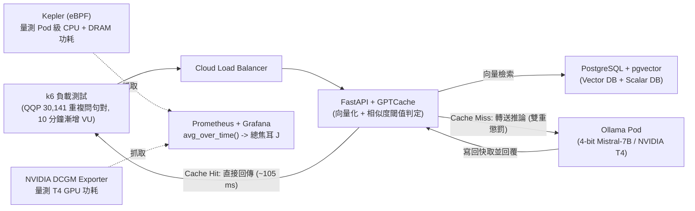

# 大型語言模型推論中語意快取的能耗與效能權衡（Chen, 2025）

> **一句話總結（TL;DR）**：在雲端原生 GKE（NVIDIA T4 + Ollama Mistral-7B + GPTCache + pgvector）以 Kepler 與 NVIDIA DCGM 實測 CPU/DRAM/GPU 總能耗，首次量化證明語意快取的節能效益高度非線性——寬鬆閾值 `0.70–0.75` 可省電 **43.7%**、延遲大降 99.6%，但閾值調嚴至 **`0.85` 即出現「效益反轉點（Benefit Inversion Point）」**，因查詢失敗開銷＋GPU 推論雙重懲罰，反比**不裝快取多耗電 +12.7%**。

---

## 1. 研究動機與問題定義
- **推論能耗主導 AI 碳足跡**：產業估計推論階段佔機器學習雲端運算需求 80–90%（總能耗 60–70%）。
- **互動式 LLM 無法套用批次減碳法**：傳統綠能軟體的「時間轉移（等綠電再跑）」或「空間轉移」不適用於低延遲互動服務。
- **語意快取（Semantic Caching）的未知能耗帳**：不同於傳統 Exact Match 快取，語意快取（如 GPTCache）需執行文字向量化（Embedding）與向量庫相似度檢索；學界過去多聚焦省 API 費用與延遲，缺乏對**整機總能耗（焦耳 J）**與關鍵超參數 `similarity_threshold` 非線性影響的實證量測。
- **明確範疇**：本研究鎖定**單輪、特定領域問答（如 FAQ 系統）**，並將「效能（Performance）」嚴格定義為**回應延遲（Latency）**。

---

## 2. 前置知識（Prerequisites）
- [語意快取與效益反轉點（Benefit Inversion Point）](../concepts/semantic-caching-and-benefit-inversion.md) — GPTCache Hit/Miss 路徑、CPU 卸載原理與「雙重懲罰（Double Penalty）」機制。
- [LLM 推論效率、量化部署與綠能權衡](../topics/llm-inference-efficiency-and-deployment.md) — 從模型選型、量化到語意快取與碳感知排程的部署優化全貌。
- [QQP 語意快取壓測基準](../benchmarks/qqp-semantic-cache.md) — 本篇壓測負載設計與無負例盲區備註。

---

## 3. 核心方法與雲端原生實驗架構

### 3.1 系統硬體與軟體堆疊（全由 Terraform 宣告式佈建）
- **雲端環境**：Google Kubernetes Engine（GKE）單節點叢集，配備 1 張 **NVIDIA T4 GPU**。
- **推論服務**：**Ollama** 部署 **4-bit 量化 Mistral-7B**。
- **語意快取層**：**GPTCache** 整合於 FastAPI，後端採 **pgvector**（向量檢索）＋ **PostgreSQL**（快取答案存放）。
- **全棧能耗觀測**：
  - **Kepler**（透過 eBPF 採集核心計數器並以 ML 模型推估 Pod 級 CPU/DRAM 功耗，因公有雲 VM 不開放 Intel RAPL）。
  - **NVIDIA DCGM Exporter**（補足 Kepler 無法直接精準量測 GPU 功耗的限制）。
  - **Prometheus** 搭配 `avg_over_time()` 計算 10 分鐘實驗區間之平均瓦特數（W）並積分換算為總焦耳數（J）。
- **嚴謹實驗控制（Clean Slate Protocol）**：對照組（無快取）與 6 組閾值（`0.70, 0.75, 0.80, 0.85, 0.90, 0.95`）**每組獨立重複執行 5 次取平均**，每次跑完徹底銷毀並重建所有 K8s 資源，排除快取殘留與記憶體碎片干擾。

---

## 4. 實驗結果與關鍵發現（Table 4.1，10 分鐘壓測，5 次平均）

| 設定 / `similarity_threshold` | Cache Hit Rate | 平均延遲 (ms) | 非 GPU 功耗 (W) | GPU 功耗 (W) | 總平均功率 (W) | 總能耗 (J) | 相對無快取能耗 |
| :--- | :---: | :---: | :---: | :---: | :---: | :---: | :---: |
| **Baseline（無快取）** | N/A | 30,294.1 | 72.21 | 83.67 | 155.88 | 93,256.2 | 基準 |
| `0.70`（寬鬆） | 99.99% | **105.4** | 37.89 | 50.80 | 88.78 | 53,269.8 | -42.9% |
| **`0.75`（最佳節能點）** | **99.99%** | 108.2 | **35.21** | 52.27 | **87.48** | **52,486.8** | **-43.7%** |
| `0.80`（臨界前緣） | 99.30% | 177.1 | 51.75 | 70.73 | 122.48 | 73,488.6 | -21.2% |
| **`0.85`（⚠️ 效益反轉峰值）** | 87.30% | 4,634.7 | **76.73** | 98.50 | **175.22** | **105,130.2** | **+12.7%** |
| `0.90`（過嚴） | 54.90% | 19,638.8 | 75.54 | **98.97** | 174.50 | 104,702.4 | +12.3% |
| `0.95`（極嚴） | 29.40% | 29,035.7 | 74.97 | 97.43 | 172.40 | 103,441.2 | +10.9% |

### 三大工程核心洞見
1. **節能本質是「GPU → CPU 運算卸載」**：在 `0.70–0.75` 時 99.99% 請求避開高耗電 GPU 推論（GPU 功率維持約 50–52 W 待機水準），總能耗省逾 `40,000 J`（-43.7%），回應速度加快近 280 倍。
2. **極高敏感度（`0.75 → 0.80`）**：命中率僅從 `99.99%` 微降 `0.69%` 到 `99.30%`，因啟動 GPU 推論代價極高，總能耗立刻暴增逾 `21,000 J`（`52,486.8 → 73,488.6 J`）。
3. **效益反轉與寄生開銷（`≥ 0.85`）**：在 `0.85` 處即使命中率仍有 `87.30%`，其餘 12.7% Miss 承受「快取查詢失敗開銷 ＋ 完整 GPU 推論」雙重懲罰，使快取從節能利器翻轉為**寄生負債（Parasitic Overhead）**，比裸跑還多燒近 `12,000 J`！

---

## 5. 限制、批判與與既有知識的關係

### 作者自述限制與 Future Work（Ch.5.3）
- 尚未測試快取淘汰策略（LRU / LFU）與回答正確率指標（BLEU / ROUGE）。
- 提出未來可建構 **Carbon-Aware Kubernetes Operator**：結合即時電網碳排 API（如 WattTime），在電網高碳時段動態調降 `similarity_threshold` 作為「優雅降級（Graceful Degradation）」手段。

### 批判性閱讀觀察
> [!WARNING]
> **1. 缺乏非重複負例與回答正確率（Accuracy / False Positive）量測**：本研究從 QQP 挑選的 30,141 組問句對 **100% 皆標記為語意重複（`is_duplicate = 1`）**（Sec. 3.2.2），且未評估低閾值（`0.70` / `0.75`）是否錯把不相關問題當成 Cache Hit（答非所問）。真實流量包含大量全新問題，實際最佳閾值與反轉點必然會向更嚴格方向偏移且取決於流量的重複率分布。

> [!WARNING]
> **2. 摘要與第 4 章實測表的數值誤植**：中英文摘要寫「當閾值設定為 `0.95` 時……使總能耗增加超過 12%，達到 `105,130` 焦耳」，但對照 Table 4.1 與 Sec. 4.2.2–4.2.3，`105,130.2 J`（+12.7%）實際上是 **`0.85` 閾值**的能耗峰值，而 `0.95` 的總能耗為 `103,441.2 J`（+10.9%）。引用時務必以 Table 4.1 實測表為準。

- **Throughput 差異未納入「每請求焦耳數（J/req）」正規化**：在固定 10 分鐘壓測下，`0.75` 因回應只要 `108 ms`，同一群虛擬使用者（VUs）完成的總請求數遠高於 `Baseline`（每次需等 `30 秒`）！若換算成**單次請求能耗（J/query）**，寬鬆快取的單位節能效益實際上比 43.7% 更加驚人；相對地，這也解釋了為何 `0.85`（`4.6s`）同時扛了大量命中查詢加上高頻 Miss 導致總功率衝到最高峰 `175.22 W`。

---

## 6. 讀書會討論題（Discussion Questions）
1. **如何衡量「總能耗」vs.「每請求能耗（J/request）」？** 在固定時間 k6 壓測中，回應越快完成的請求數越多，這對解讀 `0.85` 的 `175.22 W` 峰值有什麼影響？
2. **補上 False Positive 測試後，`0.75` 還安全嗎？** 在醫療問答（如 [吳葦誠 2024](./2024-wu-llm-finetune-dataset-from-unstructured-data.md)）或 FAQ 系統中，快取答錯的風險如何用二次輕量驗證（如 Cross-Encoder）防堵？
3. **與 [戚得郁 (2025)](./2025-chi-zero-shot-topic-classification.md) 結合**：能否先用輕量 `WC-SBERT` 判斷問題意圖類別，再針對不同類別套用不同的語意快取閾值（高風險類別設嚴、常見 FAQ 設寬）？

---

## 相關頁面
- 主題綜述：[LLM 推論效率、量化部署與綠能權衡](../topics/llm-inference-efficiency-and-deployment.md)
- 核心概念：[語意快取與效益反轉點（Benefit Inversion Point）](../concepts/semantic-caching-and-benefit-inversion.md)
- 壓測基準：[QQP 語意快取壓測基準](../benchmarks/qqp-semantic-cache.md)
- 相關論文：[戚得郁 (2025) 零樣本主題分類：BERT 與 LLM 比較](./2025-chi-zero-shot-topic-classification.md)
