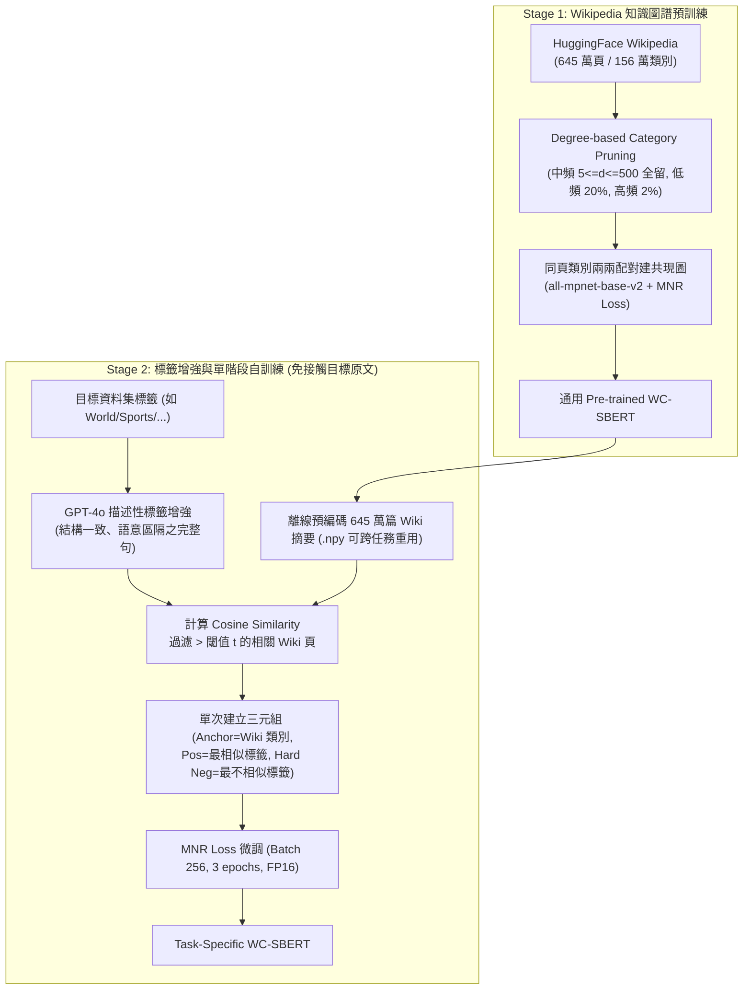

# 零樣本主題分類的進展：BERT 模型與大型語言模型的比較與分析（Chi, 2025）

> **一句話總結（TL;DR）**：提出結合「**Wikipedia 類別知識圖譜剪枝預訓練 ＋ GPT-4o 描述性標籤增強 ＋ 單階段 MNR Loss 自訓練**」的輕量編碼器 **WC-SBERT**，並與本地量化 LLM（Ollama 部署 Gemma 2、Llama 3.1/3.2、GPT-4o mini）全面基準對決，證明在結構化主題分類與資源受限場景下，優化後的輕量 SBERT（AG News `0.847`）仍可擊敗所有受測 LLM 且大幅領先推論效率。

---

## 1. 研究動機與問題定義
- **零樣本主題分類（ZSTC）的實務痛點**：真實商業環境（即時新聞監控、文件自動歸檔）常面臨無標註訓練資料且類別動態變動。
- **既有 ZSTC 路線的三個困境**：
  1. 既有自訓練法（如 Gera et al., 2022）需接觸**目標資料集無標註全文**並反覆迭代，既違反純零樣本情境，也受限於 BERT 長度與高訓練耗時；
  2. 原始類別名稱過短（如 `World`、`Artist`），在嵌入空間中語意歧義嚴重（例：`Building` 與 `Village`、`Artist` 與 `Album` 高度混淆）；
  3. 直接呼叫雲端 LLM（GPT/Gemini）雖泛化強，但面對數萬至數十萬筆分類任務時，API 成本、網路延遲與資料隱私皆成瓶頸。
- **研究定位**：以作者發表於 ACM TIST 2024 的 WC-SBERT 為基礎全面優化，並建立 BERT 系模型與本地量化 LLM 在 ZSTC 任務的系統比較基準。

---

## 2. 前置知識（Prerequisites）
- [WC-SBERT、類別剪枝與描述性標籤增強](../concepts/wc-sbert-and-label-augmentation.md) — Stage 1 維基共現圖與長尾剪枝、GPT 標籤 vs. APE、Stage 2 單階段三元組自訓練機制。
- [LLM 推論效率、量化部署與綠能權衡](../topics/llm-inference-efficiency-and-deployment.md) — 理解本地 Ollama 量化部署（`q4_0` / `q4_K_M`）與輕量專用模型的成本取捨。
- [零樣本主題分類基準總表（AG News / Yahoo / DBpedia）](../benchmarks/zstc-benchmarks.md) — 完整跨模型精度與條件對照。

---

## 3. 核心方法與工程實作細節

### 3.1 Stage 1：Wikipedia 類別共現預訓練 ＋ 長尾剪枝（Ch.3.1 & 5.2）
- **語料規模**：HuggingFace Wikipedia `6,458,670` 篇，自行爬蟲補齊 `1,563,194` 個類別，展開為 `187,720,848` 筆同頁類別正樣本對（`all-mpnet-base-v2`，MNR Loss，batch=128，max_len=128，lr=$2\times 10^{-5}$）。
- **關鍵工程發現 — 維基維護類別噪聲與 Zipf 長尾**：原始類別充滿無主題意義的編務標籤（如 `Articles containing video clips`、`Use British English`），最大度數高達 `1,013,030`。
- **Degree-based Category Pruning**：
  - 低頻（$d < 5$）隨機抽 **20%**；中頻（$5 \le d \le 500$）**100% 保留**；高頻（$d > 500$）僅抽 **2%**。
  - 類別數減至 `989,730`（-36.7%）、最大度數壓低兩個數量級至 `23,467`、熵由 `12.11` 升至 `12.95`，同時語意覆蓋率維持 `0.9910`（相似度矩陣 Pearson $r = 0.9174$）。

### 3.2 描述性標籤增強：GPT-4o 人工引導 vs. AutoPrompt（APE）（Ch.5.3–5.4）
- **三層演進**：原始標籤（`label only`）→ 手寫模板（如 `"This news article is about {label}"`）→ **GPT-4o 引導生成語意豐富且句型一致的描述句**（固定開頭、15–30 字、禁止跨類別重複用字，如 `World` → *"This news article reports on global news, international developments, and world affairs."*）。
- **對決全自動 APE（AutoPrompt，兩階段 Ranking + Generation，GPT-4o `T=0.8` 各 5 步）**：APE 產出偏向抽象百科定義（例：`World is a term that encompasses the entire planet Earth...`），句型與語氣不一致，導致嵌入空間不穩、表現大輸 GPT-4o 人工引導標籤。

### 3.3 Stage 2：單階段 MNR Loss 自訓練（Ch.3.2 & 5.5）
- **相對 ACM TIST 2024 原版之兩大改良**：
  1. **移除多輪迭代自訓練** → 改為單次挑選高信心（$\cos(p, l) > t$）維基頁面建立三元組，省算力且杜絕錯誤累積；且全程使用**預先算好存成 `.npy` 的 Wiki 摘要向量**，**不需接觸下游測試集原文**！
  2. **Online Contrastive Loss → MNR Loss**：三元組 `(Anchor=Wiki 類別 c, Pos=最大相似度標籤 l+, Hard Neg=最小相似度標籤 l-)`，批次內其餘非正標籤自動作為負樣本（Batch=256、lr=$2\times 10^{-5}$、3 epochs、FP16；閾值 $t$：AG News `0.77`、Yahoo `0.75`、DBpedia `0.77`）。

### 3.4 本地量化 LLM 實驗配置（Ch.5.6–5.7）
- 透過 **Ollama** 本地部署開源模型（Gemma 2、Llama 3.1、Llama 3.2）並對比 GPT-4o mini；API 強制設定 **`temperature = 0`** ＋ **JSON Schema Format Control**（`{"label": <integer>}`）避免輸出多餘解釋或格式錯誤；Few-shot 範例由 GPT-4o 為每類預先生成 1 筆。

---

## 4. 實驗設定與關鍵發現（詳見 [ZSTC 基準總表](../benchmarks/zstc-benchmarks.md)）

### 4.1 逐層拆解：每一項技術貢獻多少 Accuracy？（AG News / Yahoo / DBpedia）
| 階段／技術疊加 | AG News | Yahoo Answers | DBpedia | 關鍵躍升說明 |
| :--- | :---: | :---: | :---: | :--- |
| Original SBERT（`all-mpnet-base-v2`，無預訓練） | 0.654 | — | — | 基線（Table 5.7） |
| + Wiki 預訓練（未剪枝） | 0.695 | — | — | Table 5.6 |
| **+ Category Pruning（剪枝預訓練，label only）** | **0.749** (+7.8%) | 0.570 | 0.614 | 剪枝治長尾效應顯著（Table 5.6, 5.8） |
| + 手寫模板 Descriptive Label | 0.813 (+8.6%) | 0.622 (+9.2%) | 0.718 (+17.0%) | 解決單字標籤語意單薄（Table 5.8） |
| **+ GPT-4o 描述性標籤增強** | **0.836** (+2.8%) | **0.643** (+3.4%) | **0.883** (+23.0%) | **單項最大增益**；大勝 APE `0.693`（Table 5.13, 5.16） |
| **+ 單階段 MNR Self-Training（最終 WC-SBERT）** | **0.847** (+1.3%) | **0.649** (+0.9%) | **0.886** (+0.3%) | 全面微幅超越原版 Chi & Jang (2024)（Table 5.18, 5.20） |
| *(參考上限)* 全監督微調 BERT（Ding et al., 2022） | 0.944 | 0.753 | 0.993 | 需完整標註訓練集（Table 5.2） |

### 4.2 WC-SBERT 正面對決本地量化 LLM（Table 5.19，Accuracy）
| 模型（Prompt 設定） | AG News | Yahoo Answers | DBpedia | 觀察 |
| :--- | :---: | :---: | :---: | :--- |
| **WC-SBERT（輕量 Encoder）** | **0.847** | 0.649 (Top 3) | 0.886 (Top 3) | **AG News 奪冠**；跨資料集最穩、延遲與算力遠低於 LLM |
| **Gemma 2**（Zero-shot / Few-shot） | 0.817 / 0.832 | **0.659** / 0.654 | 0.903 / **0.915** | LLM 中最強最穩；在 Yahoo 上 Few-shot 無明顯增益 |
| GPT-4o mini（Zero-shot / Few-shot） | 0.574 / 0.655 | 0.453 / 0.509 | 0.765 / 0.841 | 高度依賴 Few-shot（+7.6%～+8.1%），但表現意外低於 Gemma 2 |
| Llama 3.1（Zero-shot / Few-shot） | 0.673 / 0.680 | 0.528 / 0.572 | 0.707 / 0.761 | 中段表現 |
| Llama 3.2（Zero-shot / Few-shot） | 0.532 / 0.601 | 0.425 / 0.461 | 0.592 / 0.649 | 最弱，作者推測受小模型量化精度損失影響 |

---

## 5. 限制、批判與與既有知識的關係

### 作者自述限制（Ch.6.2）
- **自訓練閾值 $t$ 仍靠人工調整**（0.75–0.77），尚未自動化（未來可探索分位數如 90th percentile 或動態統計門檻）。
- **尚未探索混合路由（Hybrid）**：例如先用 WC-SBERT 快速分類，僅將低信心邊界樣本交給 LLM 複核。

### 批判性閱讀觀察
> [!WARNING]
> **1. Self-Training 的邊際效益 vs. GPT 標籤增強的主功勞**：從 Table 5.8 → 5.13 → 5.18 拆解來看，DBpedia 最大的跳躍來自 GPT-4o 描述性標籤（`0.718 → 0.883`，+16.5 個百分點），而後續整個 Stage 2 Self-Training 僅微增 `+0.3%`（`0.883 → 0.886`），AG News 亦僅 `+1.1` 個百分點（`0.836 → 0.847`）。在實務導入時，光是「剪枝預訓練＋GPT 描述性標籤」就已吃下超過九成紅利。

> [!WARNING]
> **2. 本地 LLM 基準表的量化與規格缺漏（Table 5.19）**：Ch.5.6.1 詳細介紹了 `q4_0`、`q4_K_M` 等量化後綴，但 Table 5.19 未標明 Gemma 2 / Llama 3.1 / Llama 3.2 具體採用的參數量（如 9B vs 27B、8B vs 70B、1B vs 3B）與確切量化格式，也沒有量化比較 WC-SBERT 與各 LLM 的實際推論延遲（ms/sample）與 GPU 功耗。

- **數據勘誤備忘**：Ch.6 p.80 寫 GPT 標籤讓 DBpedia 提升 `18.5%`，但對照 Table 5.13 實為 `0.718 → 0.883`（絕對 +16.5 個百分點、相對 +23.0%）；另 Table 5.19 中 GPT-4o mini AG News Zero-shot Accuracy 僅 `0.574`、Few-shot Recall `0.524` 顯著低於 Accuracy `0.655`，疑似受嚴格整數輸出格式外溢或類別失衡預測影響。
- **與 [陳冠錞 (2025)](./2025-chen-semantic-caching-energy-tradeoff.md) 的互補連結**：兩篇皆使用 Ollama 本地部署 4-bit 量化 LLM；戚得郁從「**模型選型降維（用 SBERT 取代 LLM）**」省算力，陳冠錞則從「**推論層語意快取（GPTCache）**」省算力與電力。

---

## 6. 讀書會討論題（Discussion Questions）
1. **為什麼全自動 APE（`0.693`）慘敗給人工引導的 GPT-4o 標籤（`0.836`）？** 對比 [Wu (2024)](./2024-wu-llm-finetune-dataset-from-unstructured-data.md) 的 Critique LLM，為何沒有下游目標分布錨定的自動優化容易跑偏成「泛百科定義」？
2. **輕量編碼器＋LLM 的混合路由**：如果把 WC-SBERT 的最高與次高類別 Cosine Similarity 差值（Margin）當信心分數，只把低信心樣本丟給 Gemma 2，能否同時兼顧 90%+ 準確率與極低延遲？
3. **DBpedia 混淆矩陣啟示**：`Building` 有 3,599 筆被誤分為 `Village`（因建築描述常提所在地村莊），這反映了 Bi-Encoder 向量平均池化的什麼本質限制？

---

## 相關頁面
- 主題綜述：[封閉領域知識導入 LLM 路線總覽](../topics/domain-specific-llm-adaptation.md)、[LLM 推論效率、量化部署與綠能權衡](../topics/llm-inference-efficiency-and-deployment.md)
- 核心概念：[WC-SBERT、類別剪枝與描述性標籤增強](../concepts/wc-sbert-and-label-augmentation.md)
- 公開基準：[零樣本主題分類基準總表（AG News / Yahoo / DBpedia）](../benchmarks/zstc-benchmarks.md)
- 相關論文：[陳冠錞 (2025) LLM 推論中語意快取的能耗與效能權衡](./2025-chen-semantic-caching-energy-tradeoff.md)
- 相關簡報：[零樣本主題分類：WC-SBERT vs. 本地量化 LLM（教學型 HTML 投影片）](../../slides/2026-11-23-zero-shot-topic-classification-wc-sbert-vs-llm.html)
