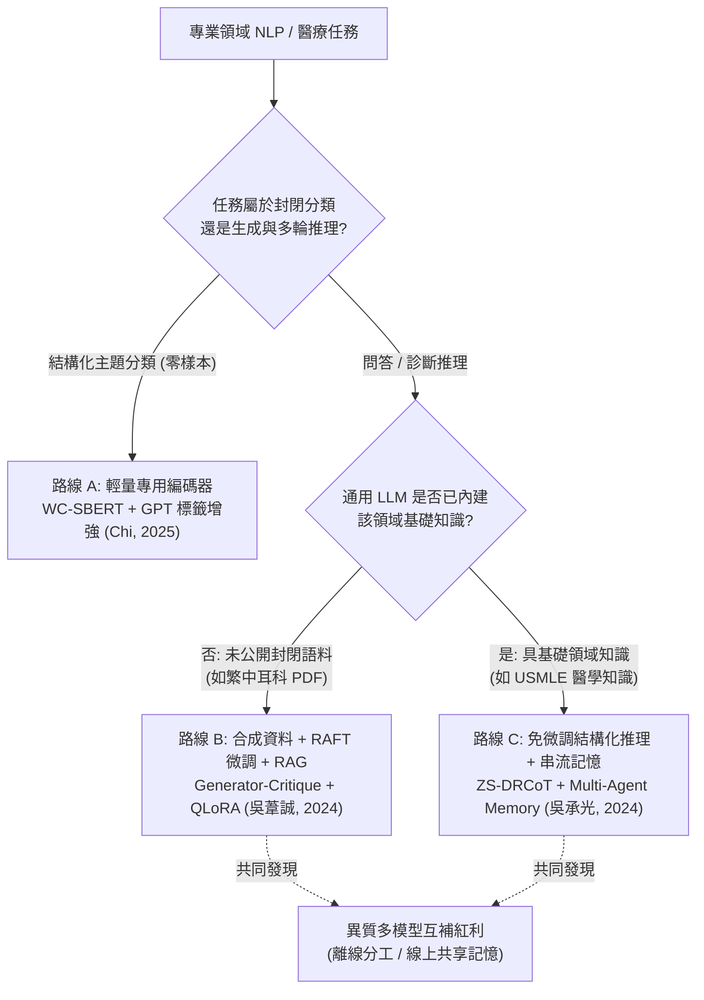

# 封閉領域知識導入 LLM 路線總覽

> **核心問題**：面對專業領域任務（醫療問答、臨床診斷推理、特定主題分類），我們應該「改權重微調（RAFT / QLoRA）」、「免微調靠提示與外掛記憶（ZS-DRCoT + Shared Memory）」，還是根本「改用輕量專用模型（WC-SBERT）」？

---

## 1. 技術路線決策脈絡圖

---

## 2. 跨論文五大技術路線工程對照表

| 方法路線 | 代表論文 | 需改 LLM 權重？ | 需人工標註？ | 核心技術機制 | 實測代表表現與適用場景 |
| :--- | :--- | :---: | :---: | :--- | :--- |
| **TAPT / 繼續預訓練** | Gururangan et al. (2020) | 是（全參） | 否 | 原始文本繼續語言模型預訓練 | 耗算力、小語料難學好（PubMedQA `25.1`） |
| **純 RAG** | Lewis et al. (2020) | 否 | 否 | 推論期向量檢索拼接上下文 | 部署最快，但 7B 小模型易受干擾段落分心（Breeze 純 RAG F1 僅 `0.3471`） |
| **合成資料 + [RAFT](../concepts/raft.md) + RAG** | [吳葦誠 (2024)](../papers/2024-wu-llm-finetune-dataset-from-unstructured-data.md) | 是（QLoRA） | 幾乎免 | [Generator–Critique 管線](../concepts/llm-synthetic-qa-critique-pipeline.md) ＋ 80/20 干擾開書微調 | 適合**未公開封閉小語料＋小模型**（Breeze F1 `0.359 → 0.556`） |
| **免微調推理 + 共享串流記憶** | [吳承光 (2024)](../papers/2024-wu-ck-llm-diagnostic-reasoning.md) | **否** | **否**（需環境回饋） | [JSON `ZS-DRCoT` ＋ Round-Robin 共享記憶](../concepts/diagnostic-reasoning-cot-and-shared-memory.md) | 適合**模型已有基礎知識且可獲回饋之推理**（DDXPlus `52.85% → 90.48%`） |
| **輕量專用編碼器 + 標籤增強** | [戚得郁 (2025)](../papers/2025-chi-zero-shot-topic-classification.md) | 僅輕量 SBERT | 否 | [維基圖譜剪枝 ＋ GPT 描述性標籤 ＋ 單階段 MNR](../concepts/wc-sbert-and-label-augmentation.md) | 適合**零樣本主題分類與高併發低成本場景**（AG News `0.847` 勝所有受測 LLM） |

---

## 3. 跨論文收斂的四大工程法則
1. **[異質多模型協作紅利](../concepts/heterogeneous-multi-llm-collaboration.md)**：吳葦誠（TAIDE 生題 + Breeze 嚴審）與吳承光（GPT/Gemini/Claude 輪詢共享記憶）雙篇獨立證實，混搭互補模型遠勝單模型。
2. **結構化格式約束（Schema / Format Control）普遍有效**：無論是 `ZS-DRCoT` 的四欄位 JSON、吳葦誠 Critique 的 `評分:/評估:`，或戚得郁 Ollama 的 JSON integer schema，明確約束輸出格式皆大幅提升穩定性。
3. **人工領域引導仍勝全自動黑箱優化**：戚得郁證明「人工寫好約束再叫 GPT-4o 產標籤（`0.836`）」大勝全自動 APE（`0.693`）；吳葦誠與吳承光的 Prompt 亦高度依賴領域專家定義的審查指標與臨床思維步驟。
4. **別盲目迷信單一銀彈**：純 RAG 會讓 7B 小模型分心；`ZS-DRCoT` 在「呼吸困難」等高歧義主訴反而出現負遷移（`-2.20%`）；全自動微調拒答樣本過多會拖累正例 Recall。

---

## 4. 現存開放問題（Open Problems）
- **無即時標準答案時如何持續學習**：將吳承光的串流記憶庫結合 Critique 審查或人類抽檢，以解除即時 $fb_t$ 依賴。
- **混合架構融合**：結合輕量 `WC-SBERT` 前置路由 ＋ `RAFT` 微調專家模型 ＋ 動態記憶庫，打造分層成本最佳解。
- **基準公平性待核對**：[PubMedQA](../benchmarks/pubmedqa.md) 開書／閉書比較條件與真實電子病歷外推表現仍待後續論文補足。

---

## 收錄論文與相關頁面
- 收錄論文：[吳葦誠 (2024)](../papers/2024-wu-llm-finetune-dataset-from-unstructured-data.md)、[吳承光 (2024)](../papers/2024-wu-ck-llm-diagnostic-reasoning.md)、[戚得郁 (2025)](../papers/2025-chi-zero-shot-topic-classification.md)
- 核心概念：[RAFT](../concepts/raft.md)、[LLM 合成問答與 Critique 管線](../concepts/llm-synthetic-qa-critique-pipeline.md)、[ZS-DRCoT 與共享記憶](../concepts/diagnostic-reasoning-cot-and-shared-memory.md)、[WC-SBERT 與標籤增強](../concepts/wc-sbert-and-label-augmentation.md)、[異質多模型協作](../concepts/heterogeneous-multi-llm-collaboration.md)
- 相關主題：[LLM 推論效率、量化部署與綠能權衡](./llm-inference-efficiency-and-deployment.md)
- 公開基準：[PubMedQA](../benchmarks/pubmedqa.md)、[PrivacyQA](../benchmarks/privacyqa.md)、[DDXPlus](../benchmarks/ddxplus.md)、[ZSTC 基準總表](../benchmarks/zstc-benchmarks.md)
- 相關簡報：[台大 LLM 工程實戰全景：全館 4 篇獨立論文統整（HTML 投影片）](../../slides/2026-11-23-ntu-llm-engineering-all-papers-synthesis.html)
