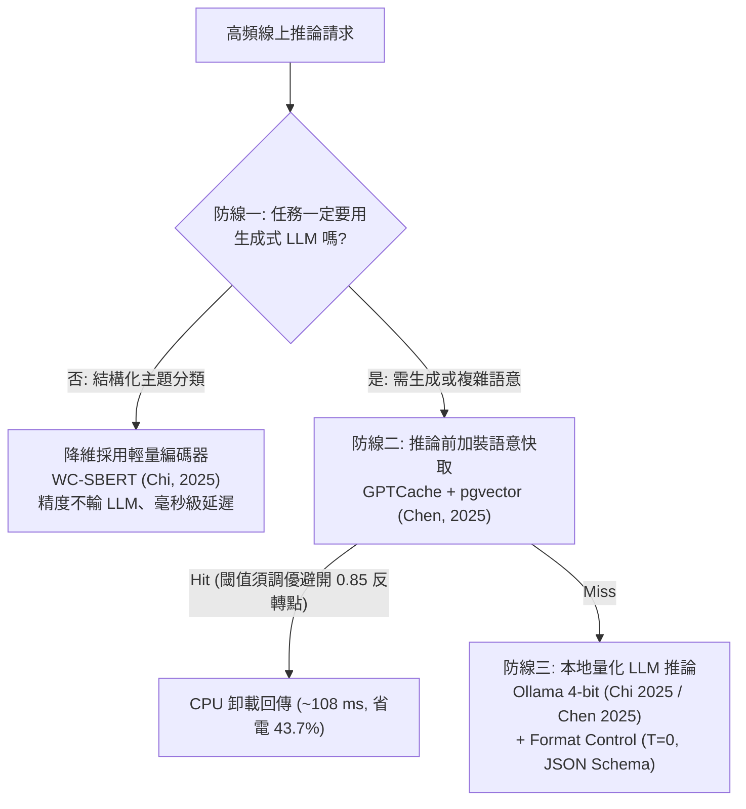

# LLM 推論效率、量化部署與綠能權衡

> **核心問題**：推論階段佔 AI 雲端運算需求 80–90%——在資源受限與永續減碳（Green AI）的現實約束下，工程團隊該如何從「**模型降維選型**」、「**本地量化部署**」與「**推論層語意快取**」三道防線控管延遲、算力與耗電量？

---

## 1. 三道推論優化防線脈絡圖

---

## 2. 兩篇實證論文的互補洞見對照

| 優化層級 | 代表論文 | 技術棧與方法 | 核心實證數據 | 關鍵避坑提醒 |
| :--- | :--- | :--- | :--- | :--- |
| **模型降維 ＋ 本地量化對決** | [戚得郁 (2025)](../papers/2025-chi-zero-shot-topic-classification.md) | `WC-SBERT` (`all-mpnet-base-v2`) vs. **Ollama** 本地量化 LLM（Gemma 2 / Llama 3.1 / Llama 3.2） | AG News：`WC-SBERT` **`0.847`** 擊敗所有受測 LLM（Gemma 2 `0.832`、GPT-4o mini `0.655`、Llama 3.2 `0.601`）；DBpedia `0.886` 緊追 Gemma 2 `0.915` | 小模型過度量化（如 Llama 3.2）在分類任務易出現嚴重掉點；勿用牛刀殺雞 |
| **語意快取 ＋ 雲端能耗觀測** | [陳冠錞 (2025)](../papers/2025-chen-semantic-caching-energy-tradeoff.md) | GKE（T4）＋ **Ollama（4-bit Mistral-7B）**＋ GPTCache ＋ pgvector ＋ Kepler（CPU/DRAM）＋ DCGM（GPU） | `threshold = 0.75`：延遲 `30.3s → 108ms`、總能耗 `93.3 kJ → 52.5 kJ`（**-43.7%**）；但 **`0.85` 發生效益反轉**，總能耗反升至 `105.1 kJ`（**+12.7%**） | 快取並非裝了就省電！閾值過嚴會引發「CPU 檢索＋GPU 推論」雙重懲罰 |

---

## 3. 現存爭議與未來整合方向
- **正確率 vs. 延遲 vs. 能耗三角權衡（Accuracy–Latency–Energy Triangle）**：陳冠錞 (2025) 量化了延遲與能耗，但尚未測量低閾值下的答錯率；戚得郁 (2025) 量化了精度，但未量測本地 Ollama 各量化版本的實際瓦特數與延遲。兩者方法論正好互補。
- **動態分流與碳感知排程**：未來可將 `WC-SBERT` 作為意圖分類前置路由器，為高風險與低風險請求指派差異化語意快取閾值，並由 Carbon-Aware Kubernetes Operator 依即時電網碳排動態調控。

---

## 收錄論文與相關頁面
- 收錄論文：[戚得郁 (2025) 零樣本主題分類：BERT 與 LLM 比較](../papers/2025-chi-zero-shot-topic-classification.md)、[陳冠錞 (2025) LLM 推論中語意快取的能耗與效能權衡](../papers/2025-chen-semantic-caching-energy-tradeoff.md)
- 核心概念：[WC-SBERT、類別剪枝與描述性標籤增強](../concepts/wc-sbert-and-label-augmentation.md)、[語意快取與效益反轉點](../concepts/semantic-caching-and-benefit-inversion.md)
- 公開基準：[ZSTC 基準總表](../benchmarks/zstc-benchmarks.md)、[QQP 語意快取壓測基準](../benchmarks/qqp-semantic-cache.md)
- 相關主題：[封閉領域知識導入 LLM 路線總覽](./domain-specific-llm-adaptation.md)
- 相關簡報：[台大 LLM 工程實戰全景：全館 4 篇獨立論文統整（HTML 投影片）](../../slides/2026-11-23-ntu-llm-engineering-all-papers-synthesis.html)
