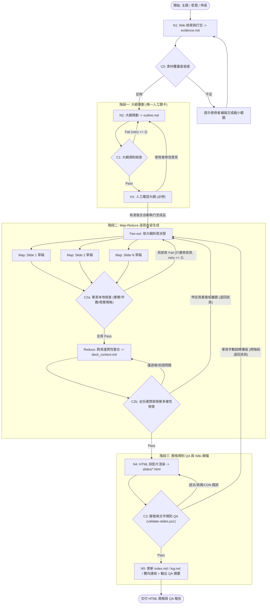

# Slide Generation StateGraph 工作流規範（`slide-graph.md`）

> 本規範定義 Paper LLM Wiki 的**投影片生成狀態圖（StateGraph）**。核心模式為：**單一人工確認關卡（H1 大綱合約）＋ 階段二 Map-Reduce 並行產頁與跨頁整合 ＋ 階段三純靜態規則 QA ＋ 檔案化狀態管理（State on Disk）**。

---

## 1. 狀態圖總覽（StateGraph）



---

## 2. 檔案化狀態目錄（State on Disk）

每次啟動簡報任務（命名 `<slug> = YYYY-MM-DD-<topic-slug>`），皆在 `slides/_work/<slug>/` 建立並保留工作狀態目錄，方便中斷續跑、局部單頁重修與 QA 稽核：

```text
paper-wiki/slides/
├── <slug>.html                   # 最終成品（單檔離線互動 HTML 投影片）
└── _work/
    └── <slug>/
        ├── state.json            # Graph 執行狀態、重試次數、各頁 QA 狀態
        ├── evidence.md           # N1 產出：Wiki 證據包（來源、關鍵數字與條件）
        ├── outline.md            # N2 產出：H1 人工核准的大綱合約
        ├── drafts/               # Map 產出：slide-01.md ~ slide-NN.md
        ├── deck_content.md       # Reduce 產出：跨頁整合後的完整內容稿
        └── qa_report.md          # C3 產出：靜態檢查腳本與人工警示摘要
```

### `state.json` 最小欄位規格
```json
{
  "slug": "2026-11-23-topic-slug",
  "phase": "outline_pending_approval",
  "goal": {
    "topic": "簡報主題",
    "audience": "受眾背景",
    "duration_min": 20,
    "target_slides": 11
  },
  "outline_approved": false,
  "retries": {
    "C1_outline": 0,
    "C2a_slides": {},
    "C2b_coherence": 0,
    "C3_render": 0
  },
  "max_retries": 2,
  "slide_status": {
    "01": "pending"
  },
  "warnings": []
}
```

---

## 3. 各節點執行規範與檢查條件

### Phase 0：檢索與打包（`N1` → `C0`）
- **`N1: Wiki Retriever`**：
  1. 先讀 `wiki/index.md`，鎖定與主題相關的所有 `papers/`、`concepts/`、`benchmarks/`、`topics/` 頁面與 `raw/assets/` 圖片清單。
  2. 抽取核心論點、實驗數據（**必附實驗條件**）、批判觀察與討論題，整理為 `evidence.md`。
- **`C0: Coverage Check`**：
  - Pass 條件：至少有 1 篇以上完整 Wiki 頁面可支撐主題，且核心實驗數據均附有條件。
  - Fail 處理：暫停並提示使用者先 `Ingest` 相關論文，或縮小簡報範圍。

---

### Phase 1：大綱規劃（`N2` → `C1` → `H1` ⚠️ 唯一人工必停關卡）
- **`N2: Outline Planner`**：依據 `evidence.md` 與 `goal` 產出合約級 `outline.md`，每一頁皆必須包含：
  - `Slide #`、`角色定位`（封面 / 動機 / 架構 / 步驟 / 實驗 / 避坑 / Q&A）
  - `標題方向`、`核心 Takeaway（1 句）`
  - `指定視覺類型`（`cover` / `svg-diagram` / `bar-chart` / `table` / `cards` / `checklist`）
  - `綁定 Wiki 來源頁`、`預估時間（分鐘）`
- **`C1: Outline Validator`（自動檢查，`max_retries = 2`）**：
  1. 敘事弧線完整（起承轉合，開頭有動機、結尾有 Takeaway / Q&A）。
  2. 總預估時間與 `goal.duration_min` 誤差在 ±20% 內。
  3. 每頁只承載 1 個核心論點（無明顯過載塞兩大主題）。
  4. 除封面頁外，每頁皆綁定明確的 `evidence.md` / Wiki 來源。
  5. 視覺多樣性：大綱階段即不可規劃連續 ≥ 3 頁純文字條列。
- **`H1: Human Approval Gate`（必停）**：
  - 將 `outline.md` 摘要呈現給使用者確認，更新 `state.json` 為 `outline_pending_approval`。
  - ⚠️ **未取得使用者明確核准前，嚴禁進入 Phase 2！**
  - 若使用者提出增刪頁或調整重心 → 記錄至 `state.json` 並退回 `N2` 修訂；核准後設 `outline_approved = true` 並**全自動跑完 Phase 2 與 Phase 3**。

---

### Phase 2：Map-Reduce 逐頁內容生成（`Fan-out` → `Map` → `C2a` → `Reduce` → `C2b`）

#### Step 2.1：Fan-out / Map（並行產頁）
- 依 `outline.md` 逐頁產出 `drafts/slide-XX.md`（若執行環境支援平行工具呼叫或子代理，優先並行產出各頁）。
- 每頁草稿讀取「共用 `evidence.md`」＋「本頁大綱合約（附前一頁與後一頁的 Takeaway 作為過場錨點）」。
- 單頁草稿格式固定包含：`Title`、`Kicker`、`Core Bullets（≤ 5 條）`、`Visual Spec（明確圖表數據或 SVG 節點邊）`、`Citations（來源頁路徑）`、`Speaker Notes`。

#### Step 2.2：`C2a` 單頁本地檢查（每頁獨立，`max_retries = 2`）
1. **Grounding（防幻覺）**：本頁所有數字、模型名、實驗條件與論點必須 100% 能在 `evidence.md` 找到出處，不得憑空補造數據。
2. **Density（防文字牆）**：不含講者筆記與出處之可視文字不超過 **240 字**，單一卡片或區塊條列不超過 **5 條**。
3. **Visual Spec 完整性**：必須照 `outline.md` 給出具體視覺內容（例如長條圖數值、表格欄位、SVG 節點），不可只寫「這裡放一張圖」。
- **局部回退**：僅對 Fail 的 `slide_id` 重跑 Map 修正，不重寫已 Pass 的頁面。

#### Step 2.3：Reduce 跨頁整合（`R1` → `C2b`，`max_retries = 2`）
- **`R1: Coherence Integrator`**：合併全部通過 `C2a` 的 `drafts/slide-XX.md` 為 `deck_content.md`，統一潤飾跨頁過場與術語。
- **`C2b: Cross-Slide Coherence Check`**：
  1. **零冗餘重複**：前後頁無重複解釋相同數據或概念。
  2. **術語一致**：繁中翻譯與英文專有名詞全份統一（例：統一寫 `Critique LLM` 而非混寫不同譯名）。
  3. **視覺節奏**：無連續 ≥ 3 頁純文字條列，且圖表／表格／SVG 頁比例 ≥ 50%。
  4. **講者筆記銜接**：相鄰頁的 `Speaker Notes` 具備自然轉場。
- **路由**：純過場或術語微調 → 直接在 `R1` 修補；特定頁嚴重離題或與他頁重複 → 退回該頁 `Map` 重寫。

---

### Phase 3：HTML 渲染、靜態 QA 與歸檔（`N4` → `C3` → `N5`）

- **`N4: HTML Slide Renderer`**：
  - 依 `deck_content.md` 渲染為單檔離線可開之 `slides/<slug>.html`（內嵌 CSS/JS/SVG，含鍵盤換頁、`N` 講者筆記、`O` 全覽、`F` 全螢幕、深淺色切換與 `@media print` 匯出 PDF 樣式）。
  - 嚴禁引用任何外部 CDN 字型、腳本或圖片 URL。
- **`C3: Static & Text-Rule QA`（免瀏覽器，必跑驗證腳本，`max_retries = 2`）**：
  - 執行 `scripts/validate-slides.ps1 -HtmlPath <path> -ExpectedSlides <N>`，檢查：
    1. **頁數與中繼資料**：`<section class="slide">` 數量 === 核准頁數；每頁皆具備非空 `data-title` 與 `data-notes`；footer 頁碼連續正確。
    2. **離線與語法健康**：零外部 `http://` / `https://` 資源依賴（`<script src>`, `<link href>`, ``）；`<section>` / `<div>` / `<svg>` 標籤開閉配對平衡。
    3. **靜態防爆版門檻**：以「視覺寬度單位（`VisualUnits` = 全形/中文字 × 1.0 ＋ ASCII 字元 × 0.5，排除 `<style>`、`<script>`、`<svg>` 與 footer）」計算，單頁 ≤ **520 單位**（> 440 單位發 Warning 提醒精簡），單頁 `<li>` 總數 ≤ **10 條**（建議 ≤ 8）。
    4. **視覺多樣性與出處**：含視覺元件（`<svg>`、`<table>`、`.chart-group`、`.stat-row`、`.diagram-box`）之頁面比例 ≥ 50%；無連續 ≥ 3 頁純文字頁；非封面頁皆具來源標註。
  - **分流回退**：
    - 語法／標籤／頁碼／外部資源錯誤 → 退回 **`N4`** 修復 HTML。
    - 單頁文字或條列嚴重超標導致爆版風險 → **跨階段退回該頁 `Map`（`N3a`）**精簡文字後重跑渲染。
- **`N5: Wiki Bookkeeping`**：
  - 產出 `slides/_work/<slug>/qa_report.md`（含 `validate-slides.ps1` 實測結果與任何超重試上限之警示）。
  - 更新 `wiki/index.md`（`Slides` 區）、`wiki/log.md`（追加 `slide` 紀錄），並於主要來源 Wiki 頁面的「相關頁面」補上雙向連結。

---

## 4. Loop Guard（防無窮迴圈規則）

- 所有自動檢查節點（`C1`、`C2a`、`C2b`、`C3`）皆受 `max_retries = 2` 限制。
- 若單一節點或單一投影片達重試上限仍未通過，**禁止繼續迴圈**；將未通過項目寫入 `state.json.warnings` 與 `qa_report.md`，於最終交付回覆中以 `> [!WARNING]` 明確告知使用者決定是否手動調整。
